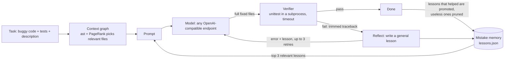

# Kintsugi

**A small, from-scratch harness that helps a small open model fix more Python bugs: it retries against real tests, writes lessons from its own mistakes, and sees only the code that matters.**

*Kintsugi* is the Japanese art of repairing broken pottery with gold: the cracks become the strongest part. Here, the model's failures become lessons that guide its next fix.

> Built for the Meta Global AI Developer Hackathon (Indie developer track).
> No runtime dependencies beyond the Python 3.10+ standard library.
> **Status:** all three modules work end to end on real models. The measured effect so far is narrow and honest: see [Results](#results).

## Highlights

- **Makes lessons for itself.** When a fix fails, the model writes its own short lesson about what went wrong. No human labels, no fine-tuning: lessons are saved, deduplicated, tested against later tasks, kept when they help and dropped when they don't.
- **Has its context graphified.** The codebase is turned into a graph of what calls, uses and imports what. For each task the harness walks that graph and hands the model only the connected code, not the whole repo.
- **Retries against real tests.** Every fix is checked by unit tests in a separate process, and the error goes back to the model for another try.
- **Honest numbers only.** Every table in this repo is generated from the benchmark's own result files, including runs that failed, were invalid or stopped early ([RESULTS.md](RESULTS.md)).

---

## How it works

Three modules, one loop:



1. **Loop: attempt, check, retry** (`src/kintsugi/loop.py`, `verifier.py`).
   The model returns whole files in fenced code blocks (an unfenced `# file:` reply is accepted too). The verifier copies the task to a temp directory, writes the files there and runs `python -m unittest` in a **separate process with a timeout**. Model output is never imported into the harness, and API keys are stripped from the child environment. On failure the trimmed traceback goes back to the model. Each retry sends only the task, the latest attempt and its error, plus one line per earlier failure, so long chains never outgrow a small context window. A reply identical to an earlier attempt (or to the original code) is called out explicitly. Retries are capped (default 3). The model may not edit tests.

2. **Mistake memory** (`src/kintsugi/memory.py`).
   After a failed attempt the model writes one short, *general* lesson ("When ... do ..."); lessons that name the task's own functions are dropped. The lesson is shown on the very next retry and stored in a JSON file with its evidence trail. Near-duplicates are merged (token Jaccard >= 0.6). On later tasks the top 3 lessons by keyword overlap and track record are added to the prompt. A lesson starts as a *candidate*, is *promoted* only after a task that used it passed, and is *pruned* after 3 uses with no win. A task is never shown a lesson that only it produced. If the API itself fails (rate limit, timeout), nothing is learned or punished.

3. **Context graph** (`src/kintsugi/graph.py`).
   Every source file is parsed with `ast` into definitions (functions, classes, methods, constants, modules) and edges (calls, name references, imports). The names used by the tests (and named in the description) seed a **personalized PageRank**. The model then sees the full text of the top-ranked files (the only files it may edit), read-only snippets of connected definitions elsewhere, and a signature-only map of the rest.

Try the graph on a benchmark task:

```
$ kintsugi graph benchmark/tasks/m08_scheduler
22 definitions, 13 edges
  jobs.<module> --imports--> schedule_config.INTERVALS
  jobs.interval_for --references--> schedule_config.INTERVALS
  jobs.next_run --calls--> jobs.interval_for
  ...
Files shown in full for this task: jobs.py, schedule_config.py
```

## Quick start

```bash
git clone https://github.com/niranjanpatil0808-max/KINTSUGI.git && cd KINTSUGI
python -m venv .venv && source .venv/bin/activate
pip install -e .

# Offline: the harness's own tests, the benchmark check, and the pipeline on the mock model
python -m unittest discover -s tests
python benchmark/check_tasks.py              # every bug fails, every reference fix passes
python benchmark/run_benchmark.py --model mock

# Real model: any OpenAI-compatible endpoint (defaults to Groq)
export GROQ_API_KEY=...                      # free key from console.groq.com
kintsugi models                              # which model names does my key allow?
export KINTSUGI_MODEL=qwen/qwen3.8-27b       # pick one from that list
kintsugi fix benchmark/tasks/s03_binary_search -v
python benchmark/run_benchmark.py --model openai
```

Other endpoints (Meta Llama API, Together, Fireworks, a local Ollama server):

```bash
export KINTSUGI_BASE_URL=http://localhost:11434/v1   # e.g. Ollama
export KINTSUGI_MODEL=llama3.1:8b
export KINTSUGI_API_KEY=anything
export KINTSUGI_MAX_TOKENS=4096                      # keep prompt + max_tokens under your per-minute limit
```

**Running the benchmark without a computer.** `.github/workflows/benchmark.yml` runs it on GitHub's servers. Add your key as the repository secret `KINTSUGI_API_KEY`, edit `benchmark/run.config` (base URL, then one `model|max_tokens|repeats|modes` entry per model) and push: the run starts and commits its results to `results/`. Rebuild the all-runs page with `python benchmark/build_results_md.py`.

## Benchmark

32 hand-written bug-fix tasks in `benchmark/tasks/`, each with a description, buggy code and a `unittest` suite. Reference fixes live in `benchmark/solutions/` and are never shown to the model. `benchmark/check_tasks.py` verifies that every buggy version fails and every reference fix passes.

- **16 single-function bugs**, easy and medium (off-by-one, wrong operator, missing sort, wrong wrap-around, tie ordering, ...).
- **8 multi-file mini-projects** where the fix depends on another file (a helper, a constant, an error class, a units comment) and two unrelated "distractor" files add noise.
- **8 hard tasks** with long, rule-heavy specifications (semantic-version precedence, word wrapping, a TTL cache, CSV quoting, topological sort, largest-remainder money splitting, business days, nested run-length decoding).
  **These were added after the first real runs**, because the original 24 tasks were passed 100% in every mode by both capable models and so could not separate the modes. I wrote all 8 before running any model on them and kept all of them whatever the results were.
- **Split** (`benchmark/split.json`): 11 warmup tasks and 21 held-out tasks (5 of them hard). Memory modes learn on warmup first; **pass rates are reported on the held-out tasks only**. Memory keeps learning while it goes through the held-out tasks one after another, but no task ever sees its own lesson.

| Mode | Retries | Memory | Context |
|---|---|---|---|
| `baseline` | 0 | no | all files |
| `loop` | 3 | no | all files |
| `loop+memory` | 3 | yes | all files |
| `full` | 3 | yes | context graph |

## Results

**Which models.** The free Groq account used here offers no Llama chat model (Groq's list for this key: `allam-2-7b`, `openai/gpt-oss-20b`, `openai/gpt-oss-120b`, `qwen/qwen3.8-27b`, plus speech and safety models). **None of the models measured is from Meta.** The harness is model-agnostic and the hackathon target is Llama-class models, so running the same workflow on a Llama endpoint is the first thing to do with a key for one.

**What the data shows so far** (details and every run: [RESULTS.md](RESULTS.md)):

1. **Retrying against the tests works.** On `qwen/qwen3.8-27b` the baseline fails 2 of 21 held-out tasks (`s14_fibonacci` and `h08_nested_decode`). In `loop` mode both are repaired after the model sees the test error, in both complete runs on the 32-task set. The first attempt of `loop` is the same request as the baseline's, so the retry is what changed the outcome. That is 2 tasks out of 21 in one model: a real but small effect.
2. **Memory and the context graph show no measurable effect yet.** The models already pass almost everything, so there is nothing for them to improve. The memory module does what it should (the model wrote general lessons such as *"When implementing parsers or decoders, ensure that validation for structural integrity, such as balanced delimiters, is performed after processing the entire input"*; the lessons were shown to later tasks and promoted after those tasks passed), but I cannot claim it improved a pass rate.
3. **The weak model could not be measured fairly yet.** `allam-2-7b` (7B) is the only model here with headroom (2/16 baseline on the original set), but its runs hit a parser bug of mine and Groq's daily token limit. Complete runs of it are scheduled once the quota resets.
4. **`gpt-oss-20b`:** baseline 20/21 on the 32-task set; its retry modes did not finish because of the 200,000 tokens-per-day limit.

**Main table** (`qwen/qwen3.8-27b`, 32-task set, 21 held-out tasks, one run, first version of the retry loop; copied unchanged from `results/20261021-163652-openai.md`):

Model: `qwen/qwen3.8-27b` · held-out tasks: 21 (5 hard) · repeats: 1 · max retries: 3 · temperature: 0.0

| Mode | Pass rate (held-out) | Hard tasks only | Avg attempts | Model calls (scored tasks) | Tokens (scored tasks) |
|---|---|---|---|---|---|
| baseline | 90% (19/21) | 80% (4/5) | 1.00 | 21 | 15,219 |
| loop | 100% (21/21) | 100% (5/5) | 1.10 | 23 | 19,127 |
| loop+memory | 100% (21/21) | 100% (5/5) | 1.05 | 23 | 17,218 |
| full | 100% (21/21) | 100% (5/5) | 1.05 | 23 | 15,250 |

A later run with the bounded-context loop gave the same baseline, loop and loop+memory results (`full` was stopped by the daily quota); see [RESULTS.md](RESULTS.md).

**Invalid and incomplete runs are kept, not hidden.** One `gpt-oss-20b` run was invalid (my token setting made Groq reject many requests; the code of that day scored them as failures); several runs stopped at the daily token limit; one `allam-2-7b` run was dominated by a parser bug. [RESULTS.md](RESULTS.md) lists all of them with the reason.

## Credits and inspirations

Ideas only; all code here is written from scratch. Licenses were checked on each repository page on 2026-10-21.

| Project | License | Idea taken | Where it lives here |
|---|---|---|---|
| [google-research/harness2](https://github.com/google-research/harness2) | Apache-2.0 | Improve the harness around a frozen model; keep a change only when it measurably wins, and carry lessons forward to future tasks | Lessons are promoted only after a task that used them passed, and pruned when they never help |
| [noahshinn/reflexion](https://github.com/noahshinn/reflexion) | MIT | Verbal self-reflection after a failure, fed into the next attempt | The "write one general lesson" step and showing it on the retry |
| [SWE-agent/mini-swe-agent](https://github.com/SWE-agent/mini-swe-agent) | MIT | A tiny agent loop that skips the tool-calling API, so any model works | Plain-text prompt in, fenced code blocks out; one short loop |
| [Aider-AI/aider](https://github.com/Aider-AI/aider) (repo map) | Apache-2.0 | A map of definitions and references ranked with PageRank, personalized to the current task, within a size budget | `graph.py`: stdlib PageRank over the `ast` graph, seeded by test names |
| [ReflexioAI/reflexio](https://github.com/ReflexioAI/reflexio) | Apache-2.0 | Turn repeated corrections into lasting, deduplicated behavior changes | Near-duplicate lessons merge and count how often they recur |
| [PrimeIntellect-ai/prime-agent](https://github.com/PrimeIntellect-ai/prime-agent) | MIT | Harness state (prompts, memories) kept as durable files, updated in small evidence-backed steps | `lessons.json` is plain data; every change records the task and outcome that caused it |

## Limitations

- **No Meta model was measured** (see Results). The claim in the project brief, that a small open model gains from the harness, is only partly tested.
- **Small effect, small sample.** The one clear gain is 2 repaired tasks out of 21, on one model, in single runs. One task is about 5 percentage points. Temperature 0 is not fully deterministic on the hosted models (the same prompts occasionally gave different results between runs).
- **Ceiling effects.** Capable models pass almost everything, which leaves no room to measure memory or the graph. Only 5 held-out tasks are hard.
- **The hard tier was added after seeing the first results** (disclosed above). All 8 were kept whatever the outcome.
- **Free-tier limits shaped the experiment.** Groq's free tier caps tokens per minute and per day (200,000 per day for `gpt-oss-20b` and `qwen3.8-27b`), so complete multi-repeat runs are not possible in one day.
- **Tasks are written by the same person who wrote the harness.** I tried to keep the bugs realistic and the descriptions neutral, but this is not an independent benchmark.
- **Graph rules were tuned on the 8 multi-file tasks.** I inspected which files it picked and fixed two rules (ignore `__dunder__` links; plain description words do not seed methods) before any model results existed. It still favours the graph on this benchmark.
- **Name-based resolution.** The graph links calls by name, not by type, so two unrelated functions with the same name can be linked.
- **Memory retrieval is keyword overlap**, not embeddings.
- **The model sees the tests.** That measures "fix to pass given tests", not "find an unknown bug".
- **Model code runs with your permissions.** The verifier uses a separate process, a temp directory and a timeout, but it is not a security sandbox.

## What's next

- Run the full ablation on a Llama model, and on `allam-2-7b`, where there is headroom to measure memory and the graph.
- More and harder tasks, including real open-source bug histories, and several temperature-above-0 repeats per mode so that noise can be measured.
- Embedding-based lesson retrieval compared against keyword retrieval; lessons written only from mistakes the model actually corrected.

## Project layout

```
src/kintsugi/   model.py  verifier.py  loop.py  memory.py  graph.py  cli.py
benchmark/      tasks/  solutions/  split.json  check_tasks.py  run_benchmark.py
                run.config  build_results_md.py  run_notes.json
results/        every measured run (JSON + table + lessons learned)
RESULTS.md      all runs, generated from results/
tests/          tests for the harness itself (python -m unittest discover -s tests)
SPEC.md         design notes and defaults
```

Tests use the standard library's `unittest` (not pytest) so a fresh clone needs no installs to run them.

## License

MIT, see [LICENSE](LICENSE).
