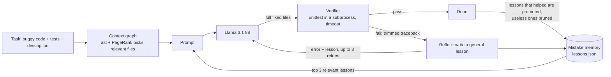

# Kintsugi

**A small, from-scratch harness that helps a weak open model (Llama 3.1 8B) fix more Python bugs by retrying against tests, remembering its mistakes, and seeing only the code that matters.**

*Kintsugi* is the Japanese art of repairing broken pottery with gold: the cracks become the strongest part. Here, the model's failures become lessons that guide its next fix.

> Built for the Meta Global AI Developer Hackathon (Indie developer track).
> No runtime dependencies beyond the Python 3.10+ standard library.

## Highlights

- **Makes lessons for itself.** When a fix fails, the model writes its own short lesson about what went wrong. No human labels, no fine-tuning: the lessons are saved, deduplicated, tested against later tasks, kept when they help and dropped when they don't.
- **Has its context graphified.** The codebase is turned into a graph of what calls, uses and imports what. For each task the harness walks that graph and hands the model only the connected code, not the whole repo.
- **Retries against real tests.** Every fix is checked by unit tests in a separate process, and the error goes back to the model for another try.
- **Honest numbers only.** Every result in this README is copied from a results file the benchmark wrote.

---

## How it works

Three modules, one loop:



1. **Loop: attempt, check, retry** (`src/kintsugi/loop.py`, `verifier.py`).
   The model returns whole files in fenced code blocks. The verifier copies the task to a temp directory, writes the files there and runs `python -m unittest` in a **separate process with a timeout** (model output is never imported into the harness, and API keys are stripped from the child environment). On failure, the trimmed traceback goes back to the model. Retries are capped (default 3). The model may not edit tests.

2. **Mistake memory** (`src/kintsugi/memory.py`).
   After a failed attempt, the model writes one short, *general* lesson ("When … do …"). The lesson is shown on the very next retry and stored in a JSON file with its evidence trail. Near-duplicate lessons are merged (token Jaccard ≥ 0.6). On later tasks the top 3 lessons by keyword overlap and track record are added to the prompt. A lesson starts as a *candidate*, is *promoted* only after a task that used it passed, and is *pruned* after 3 uses with no win. A task is never shown a lesson that only it produced.

3. **Context graph** (`src/kintsugi/graph.py`).
   Every source file is parsed with `ast` into definitions (functions, classes, methods, constants, modules) and edges (calls, name references, imports). The names used by the tests (and named in the description) seed a **personalized PageRank**. The model then sees the full text of the top-ranked files (the only files it may edit), read-only snippets of connected definitions elsewhere, and a signature-only map of the rest.

Try the graph on a benchmark task:

```
$ kintsugi graph benchmark/tasks/m08_scheduler
22 definitions, 13 edges
  jobs.<module> --imports--> schedule_config.INTERVALS
  jobs.interval_for --references--> schedule_config.INTERVALS
  jobs.next_run --calls--> jobs.interval_for
  ...
Files shown in full for this task: jobs.py, schedule_config.py
```

## Quick start

```bash
git clone https://github.com/niranjanpatil0808-max/KINTSUGI.git && cd KINTSUGI
python -m venv .venv && source .venv/bin/activate
pip install -e .

# Offline: run the harness's own tests and the benchmark pipeline on the mock model
python -m unittest discover -s tests
python benchmark/check_tasks.py              # every bug fails, every reference fix passes
python benchmark/run_benchmark.py --model mock

# Real model: any OpenAI-compatible endpoint. Defaults to Groq + llama-3.1-8b-instant.
export GROQ_API_KEY=...                      # free key from console.groq.com
kintsugi fix benchmark/tasks/s03_binary_search -v
python benchmark/run_benchmark.py --model openai
```

Other endpoints (Meta Llama API, Together, Fireworks, a local Ollama server):

```bash
export KINTSUGI_BASE_URL=http://localhost:11434/v1   # e.g. Ollama
export KINTSUGI_MODEL=llama3.1:8b
export KINTSUGI_API_KEY=anything
```

If a run hits rate limits and stops, continue it with `python benchmark/run_benchmark.py --resume results/<run>.json`.

## Benchmark

24 hand-written bug-fix tasks in `benchmark/tasks/`, each with a description, buggy code and a `unittest` suite. Reference fixes live in `benchmark/solutions/` and are never shown to the model.

- **16 single-function bugs** (off-by-one, wrong operator, missing sort, wrong wrap-around, tie ordering, ...).
- **8 multi-file mini-projects** where the fix depends on another file (a helper, a constant, an error class, a units comment) and two unrelated "distractor" files add noise.
- **Split** (`benchmark/split.json`): 8 warmup tasks (5 single, 3 multi) and 16 held-out tasks (11 single, 5 multi). Memory modes learn on warmup first; **all pass rates are reported on the 16 held-out tasks only**. Memory keeps learning while it goes through the held-out tasks one after another, but no task ever sees its own lesson.

| Mode | Retries | Memory | Context |
|---|---|---|---|
| `baseline` | 0 | no | all files |
| `loop` | 3 | no | all files |
| `loop+memory` | 3 | yes | all files |
| `full` | 3 | yes | context graph |

## Results

**Not measured yet.** No real-model run has been done so far, so there is no result to report. This section will contain only the table that `benchmark/run_benchmark.py` writes to `results/<run>.md`, copied unchanged, with the model name and number of tasks. If the harness (or one of its modules) does not help, this section will say so.

## Credits and inspirations

Ideas only; all code here is written from scratch. Licenses were checked on each repository page on 2026-10-21.

| Project | License | Idea taken | Where it lives here |
|---|---|---|---|
| [google-research/harness2](https://github.com/google-research/harness2) | Apache-2.0 | Improve the harness around a frozen model; keep a change only when it measurably wins, and carry lessons forward to future tasks | Lessons are promoted only after a task that used them passed, and pruned when they never help |
| [noahshinn/reflexion](https://github.com/noahshinn/reflexion) | MIT | Verbal self-reflection after a failure, fed into the next attempt | The "write one general lesson" step and showing it on the retry |
| [SWE-agent/mini-swe-agent](https://github.com/SWE-agent/mini-swe-agent) | MIT | A tiny agent loop that skips the tool-calling API, so any model works | Plain-text prompt in, fenced code blocks out; one short loop |
| [Aider-AI/aider](https://github.com/Aider-AI/aider) (repo map) | Apache-2.0 | A map of definitions and references ranked with PageRank, personalized to the current task, within a size budget | `graph.py`: stdlib PageRank over the `ast` graph, seeded by test names |
| [ReflexioAI/reflexio](https://github.com/ReflexioAI/reflexio) | Apache-2.0 | Turn repeated corrections into lasting, deduplicated behavior changes | Near-duplicate lessons merge and count how often they recur |
| [PrimeIntellect-ai/prime-agent](https://github.com/PrimeIntellect-ai/prime-agent) | MIT | Harness state (prompts, memories) kept as durable files, updated in small evidence-backed steps | `lessons.json` is plain data; every change records the task and outcome that caused it |

## Limitations

- **Small, hand-written benchmark.** 24 tasks (16 scored) are enough to show a direction, not a precise effect size. One task is about 6 percentage points.
- **Tasks are written by the same person who wrote the harness.** I tried to keep the bugs realistic and the descriptions neutral, but this is not an independent benchmark.
- **Graph rules were tuned on these tasks.** While building the graph I inspected which files it picked for the 8 multi-file tasks and fixed two rules (ignore `__dunder__` links; plain description words do not seed methods). This was done before any model results existed, but it still favours the graph on this benchmark.
- **Name-based resolution.** The graph links calls by name, not by type, so two unrelated functions with the same name can be linked.
- **Memory retrieval is keyword overlap**, not embeddings. Simple and transparent, but it can miss lessons phrased differently.
- **The model sees the tests.** That is realistic for test-driven bug fixing, but it means this measures "fix to pass given tests", not "find an unknown bug".
- **Temperature 0 and few repeats** because of free-tier rate limits.

## What's next

- More tasks, including tasks from real open-source bug histories, and an external benchmark.
- Embedding-based lesson retrieval and a comparison against keyword retrieval.
- Running the same ablation on Llama 3.3 70B or Llama 4 to see how gains change as the model gets stronger.

## Project layout

```
src/kintsugi/   model.py  verifier.py  loop.py  memory.py  graph.py  cli.py
benchmark/      tasks/  solutions/  split.json  check_tasks.py  run_benchmark.py
results/        measured runs (JSON + markdown table, lessons learned)
tests/          tests for the harness itself (python -m unittest discover -s tests)
SPEC.md         design notes and defaults
```

Tests use the standard library's `unittest` (not pytest) so a fresh clone needs no installs to run them.

## License

MIT, see [LICENSE](LICENSE).
